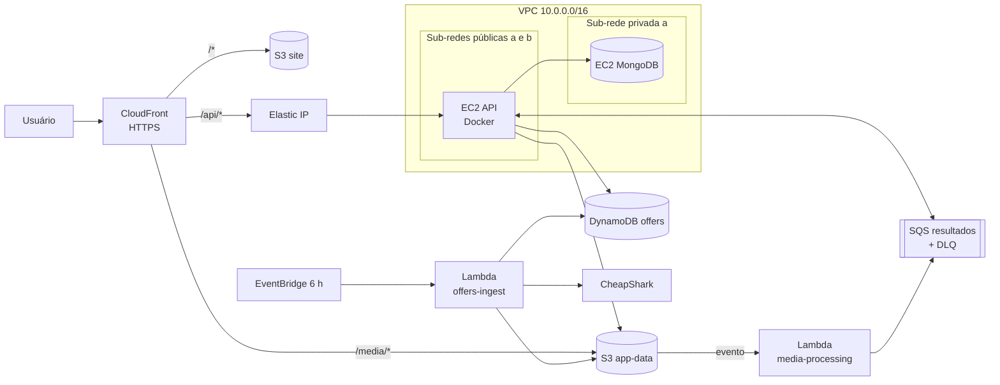
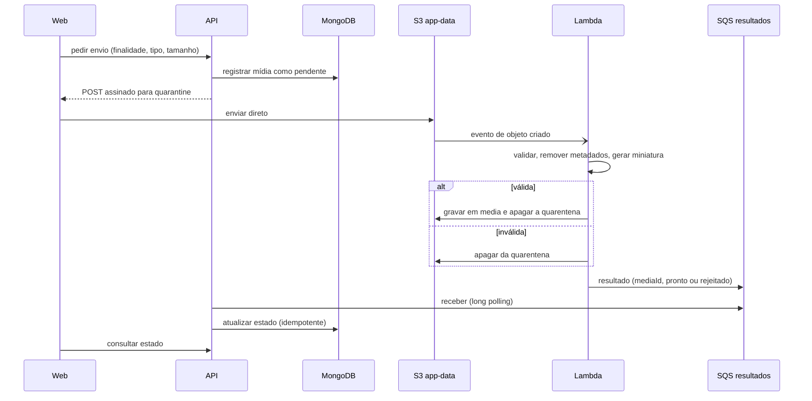

# Arquitetura de nuvem

Este documento descreve a arquitetura de infraestrutura da Plataforma Distribuída de Jogos: componentes AWS, rede, segurança, fluxos, implantação, operação e decisões. A arquitetura interna do código (módulos, camadas, portas, front-end, pilha de bibliotecas) está em [Arquitetura de software](03-arquitetura-software.md). Requisitos em [Requisitos](01-requisitos.md); contratos e modelo de dados em [Contratos e dados](04-contratos-e-dados.md); ordem de construção em [Plano de construção](05-plano-de-construcao.md); fluxo de Git em [Como contribuir](06-como-contribuir.md).

## Siglas

| Sigla         | Significado                                                     |
| ------------- | --------------------------------------------------------------- |
| AZ            | Zona de disponibilidade da AWS                                  |
| ALB           | Application Load Balancer                                       |
| CDN           | Rede de distribuição de conteúdo (aqui, o CloudFront)           |
| DLQ           | Fila de mensagens que falharam                                  |
| EIP           | Elastic IP, endereço público fixo                               |
| IaC           | Infraestrutura como código                                      |
| OAC           | Origin Access Control: acesso do CloudFront a um bucket privado |
| SG            | Security Group, o firewall de uma instância                     |
| SSM           | AWS Systems Manager (Parameter Store e acesso às instâncias)    |
| RF, RNF, REST | Requisitos funcionais, não funcionais e restrições              |

## 1. Visão geral

### 1.1 O que é

Uma loja-vitrine de jogos. **Desenvolvedores** publicam jogos autorais (um arquivo de demonstração, não jogável), **jogadores** montam a biblioteca, curtem e comentam, e uma seção de **Ofertas** exibe promoções reais de jogos do mercado, atualizadas por uma função serverless. Roda na AWS e atende aos requisitos da disciplina: duas máquinas virtuais (aplicação e banco), armazenamento de objetos pelo SDK e serviço serverless.

### 1.2 Atributos de qualidade

| Atributo               | Como o desenho responde                                                                                                       |
| ---------------------- | ----------------------------------------------------------------------------------------------------------------------------- |
| Segurança              | Buckets privados, banco sem acesso público, origem da API protegida, segredos fora do código, URLs assinadas de curta duração |
| Escalabilidade e custo | A API não trafega arquivos (vão direto ao S3); serverless para trabalho em rajadas                                            |
| Disponibilidade        | API que volta sozinha ao ligar, com recuperação operacional; banco com backup restaurável                                     |
| Operabilidade          | Infraestrutura em código, logs estruturados, painel e alarmes                                                                 |
| Manutenibilidade       | Monorepo, ambiente local reproduzível, contratos explícitos                                                                   |

### 1.3 Princípios

1. Os bytes de arquivos não passam pela API: envio e download são diretos com o S3.
2. Tudo que o usuário envia espera num lugar isolado (quarentena) até ser processado.
3. A API não tem estado local; segredos e configuração vêm de fora.
4. Serviço gerenciado é preferido quando substitui uma peça que seria preciso operar.
5. Cada limitação é uma escolha consciente e documentada (seção 8).

### 1.4 Premissas de ambiente

- O desenho considera o caso mais restrito: **AWS Academy Learner Lab** (um único papel pré-criado, credenciais temporárias, instâncias que podem ser paradas ao fim da sessão, orçamento limitado, regiões us-east-1 e us-west-2).
- Com conta própria, aplicam-se os papéis por componente descritos na seção 4.3.
- Itens que dependem do ambiente real estão na seção 10.

### 1.5 Diagrama geral



O navegador também envia e baixa arquivos direto do S3, por URLs assinadas pela API (omitido do desenho). Requisição típica: navegador, CloudFront e então site, mídia ou `/api/*` (Elastic IP, API, e daí Mongo, DynamoDB, S3 e SQS).

## 2. Componentes

### 2.1 Resumo

| Componente                     | Papel                                                                 | Configuração-chave                                                                        |
| ------------------------------ | --------------------------------------------------------------------- | ----------------------------------------------------------------------------------------- |
| CloudFront                     | Entrada única, HTTPS, cache                                           | 3 comportamentos (2.2)                                                                    |
| S3 `site`                      | Build do front (React + Vite)                                         | Privado; leitura só pelo CloudFront (OAC)                                                 |
| S3 `app-data`                  | Envios, mídia, builds, arquivo bruto das ofertas, backups             | Privado; versionamento; regras por prefixo (2.3)                                          |
| EC2 API                        | NestJS em Docker                                                      | `t3.small`; instância única; Elastic IP                                                   |
| EC2 MongoDB                    | Banco do domínio                                                      | `t3.small`; sub-rede privada; IP privado fixo; disco de 20 GB; contêiner com autenticação |
| SQS `moderation-results` e DLQ | Resultado do processamento de imagem, da Lambda para a API            | Fila padrão; 3 recebimentos e DLQ; visibilidade 60 s                                      |
| Lambda `media-processing`      | Valida a imagem, remove metadados, gera miniatura; moderação opcional | Fora da VPC; `nodejs24.x`; 512 MB; 30 s; DLQ própria                                      |
| Lambda `offers-ingest`         | Busca ofertas na CheapShark                                           | Fora da VPC; `nodejs24.x`; 256 MB; 60 s; concorrência reservada 1                         |
| EventBridge                    | Agenda a Lambda de ofertas                                            | `rate(6 hours)`                                                                           |
| DynamoDB `offers`              | Ofertas que a API lê                                                  | Sob demanda; TTL de 24 h; índice por feed e nota                                          |
| SSM Parameter Store            | Segredos e configuração                                               | `SecureString`                                                                            |
| CloudWatch e SNS               | Logs, painel, alarmes, e-mail                                         | 2.8                                                                                       |
| ECR                            | Imagens da API                                                        | Um repositório                                                                            |
| Rekognition (opcional)         | Moderação de imagem                                                   | `DetectModerationLabels`, ligado por sinalizador                                          |

### 2.2 CloudFront

| Comportamento | Origem                                          | Cache     | Observação                                                                                       |
| ------------- | ----------------------------------------------- | --------- | ------------------------------------------------------------------------------------------------ |
| `/api/*`      | DNS público do Elastic IP da API, HTTP porta 80 | Desligado | Repassa os cookies e cabeçalhos do usuário; injeta o cabeçalho secreto                           |
| `/media/*`    | S3 `app-data`, prefixo `media/`, por OAC        | Ligado    | Só mídia já processada                                                                           |
| `/*` (padrão) | S3 `site`, por OAC                              | Ligado    | Uma função do CloudFront reescreve rotas sem extensão para `/index.html`, só neste comportamento |

- Todo o tráfego entra pelo CloudFront, sem nginx. O endereço do sistema é o do CloudFront (sem domínio próprio).
- O CloudFront exige nome de domínio como origem, não número de IP; o Elastic IP tem um DNS público fixo.
- O trecho CloudFront até a API é HTTP (HTTPS exigiria domínio próprio e certificado).
- Site e API ficam na mesma origem, o que dispensa CORS.
- Páginas de erro globais do CloudFront não são usadas para o roteamento do SPA: valem para a distribuição inteira e mascarariam os 404 da API.

### 2.3 S3

#### Bucket `site`

Build estático do front. Privado, lido apenas pelo CloudFront por OAC.

#### Bucket `app-data`

| Prefixo                                       | Conteúdo                       | Quem grava                | Quem lê                   | Ciclo de vida                      |
| --------------------------------------------- | ------------------------------ | ------------------------- | ------------------------- | ---------------------------------- |
| `quarantine/{purpose}/{mediaId}`              | Envio aguardando processamento | Navegador (POST assinado) | Lambda                    | Expira em 1 dia                    |
| `media/{purpose}/{mediaId}.{ext}` e miniatura | Imagem processada              | Lambda                    | CloudFront                | Mantém; apagada com a entidade     |
| `games/{gameId}/{versionId}/{arquivo}`        | Build `.apk` ou `.zip`         | Navegador (POST assinado) | Usuário, por URL de 5 min | Mantém versões; apagado com o jogo |
| `raw/offers/{AAAA-MM-DD}/{HHmm}.json`         | Resposta crua da CheapShark    | Lambda de ofertas         | Console, reprocessamento  | Expira em 90 dias                  |
| `backups/mongo/{data}.archive.gz`             | `mongodump`                    | EC2 do Mongo              | Restauração               | Expira em 7 dias                   |

- Acesso público bloqueado; versionamento ligado, com expiração das versões antigas em 7 dias.
- CORS: `POST` e `GET` a partir do domínio do CloudFront e de `localhost`.
- Limites impostos no POST assinado: imagem até 5 MB; build até 100 MB.
- A regra de ciclo de vida da quarentena limpa os envios abandonados.

### 2.4 EC2 da API

- Instância única `t3.small` em sub-rede pública, com Elastic IP; NestJS em contêiner Docker.
- A imagem é construída de `api/Dockerfile`, publicada no ECR e executada pelo `user-data`. A atualização é a troca do contêiner por SSM.
- As credenciais temporárias do Learner Lab exigem novo login no ECR a cada sessão.
- A API não tem estado local. Segredos e configuração vêm do SSM, lidos na partida pela identidade da instância.
- Endpoint de saúde: `GET /api/health`.

### 2.5 EC2 do MongoDB

- Contêiner `mongo` (mesma versão do ambiente local, MongoDB 8.0), autenticação ligada, escutando só no IP privado, dados em volume EBS de 20 GB, política de reinício.
- Instância única, sem réplicas e sem transações multi-documento: cada operação altera um documento e a exclusão de conta é uma tarefa reexecutável.
- Instalação com internet por meio de NAT Gateway temporário (seção 4.1).
- Backup noturno com `mongodump` para o S3 (pelo endpoint de gateway) e snapshot do disco antes de marcos importantes. A restauração é testada ao menos uma vez.

### 2.6 Lambdas, SQS e EventBridge

**`media-processing`**: acionada pelo evento de objeto criado em `quarantine/`. Valida a imagem, remove metadados, gera miniatura, grava em `media/`, apaga a quarentena e envia o resultado ao SQS. Moderação com Rekognition é passo opcional, desligado por padrão. Falhas esgotadas vão à DLQ própria da Lambda. Biblioteca de imagem: `sharp`, empacotada para linux-x64 (glibc).

**`offers-ingest`**: disparada pelo EventBridge a cada 6 horas (ou manualmente). Detalhes do fluxo na seção 3.3. Concorrência reservada 1.

**SQS `moderation-results`**: fila padrão com DLQ após 3 recebimentos e visibilidade de 60 s. Transporta o resultado do processamento de imagem da Lambda para a API.

**Rede das Lambdas:** ficam fora da VPC. Precisam de internet (CheapShark) e não alcançam o Mongo; assim não exigem NAT nem interface de rede.

O processamento de imagem é orientado a evento, sem estado e em rajadas, o que justifica o uso de serverless.

### 2.7 DynamoDB `offers`

| Item       | Definição                                                                         |
| ---------- | --------------------------------------------------------------------------------- |
| Chave      | Partição `steamAppID`                                                             |
| Atributos  | Título, preços, desconto, nota, miniatura, `dealID`, `feed`, `runId`, `expiresAt` |
| Índice     | `feed` + `dealRating` (lista ordenada)                                            |
| Ponteiro   | Item `META#steam` com o `runId` da última execução completa                       |
| Capacidade | Sob demanda; TTL de 24 h em `expiresAt`                                           |

A Lambda grava os 30 itens e só depois atualiza o ponteiro: a API filtra pelo ponteiro e nunca lê uma execução pela metade.

### 2.8 Observabilidade

| Item                                | Definição                                                                                                                               |
| ----------------------------------- | --------------------------------------------------------------------------------------------------------------------------------------- |
| Logs da API                         | JSON estruturado (identificador da requisição, usuário, ação, latência), driver `awslogs`, grupo `/plataforma/api`, retenção de 14 dias |
| Logs das Lambdas                    | Grupos automáticos, retenção de 14 dias                                                                                                 |
| Painel `plataforma`                 | CloudFront (requisições, 5xx), EC2 (CPU, verificação), Lambdas (erros), filas e DLQs                                                    |
| Alarmes, com aviso por e-mail (SNS) | 5xx do CloudFront; falha de verificação da instância; erros da Lambda de ofertas; mensagem em qualquer DLQ; CPU alta                    |
| Mongo                               | Logs ficam na instância (a sub-rede privada não tem saída para o CloudWatch)                                                            |

A confirmação do e-mail do SNS é manual e deve ser feita antes de qualquer demonstração.

### 2.9 ECR, SSM e Terraform

- **ECR:** um repositório para a imagem da API.
- **SSM Parameter Store:** `SecureString` para o segredo de assinatura do token, a senha do Mongo e o cabeçalho secreto da origem. Sem custo adicional; nenhum segredo em imagem ou repositório.
- **Terraform:** descreve toda a infraestrutura (seção 5.1).

### 2.10 Custo estimado

Ordem de grandeza, a confirmar na calculadora da AWS.

| Item                                  | Estimativa                                                                                          |
| ------------------------------------- | --------------------------------------------------------------------------------------------------- |
| 2 x `t3.small` ligadas                | Cerca de US$ 1 por dia                                                                              |
| Endereços IPv4 públicos e Elastic IP  | Centavos por dia                                                                                    |
| NAT Gateway (temporário)              | Cerca de US$ 1 por dia se esquecido ligado                                                          |
| CloudFront                            | Camada gratuita permanente (1 TB e 10 milhões de requisições por mês, segundo guias); perto de zero |
| S3, Lambda, DynamoDB, SQS, CloudWatch | Centavos                                                                                            |
| **Total com tudo ligado**             | De US$ 1 a 1,5 por dia                                                                              |

Controle: parar as instâncias e destruir o NAT fora de ensaios e demonstrações; a IaC recria.

## 3. Fluxos principais

### 3.1 Cadastro, login e requisições autenticadas

O navegador chama `/api/*` pelo CloudFront. O CloudFront repassa cookies e injeta o cabeçalho secreto da origem; a API verifica o cabeçalho (403 sem ele) e processa a requisição contra o Mongo. A sessão é um JWT de acesso de 1 hora, sem refresh, em cookie `HttpOnly`, `Secure`, `SameSite=Strict`. Como site e API compartilham a origem, o cookie viaja sem CORS. A sessão expira em 1 hora e o front leva ao login. Detalhes de autenticação e autorização no código: [Arquitetura de software](03-arquitetura-software.md).

### 3.2 Envio de imagem



- A chave da quarentena carrega o `mediaId`: a Lambda não precisa do banco.
- A mensagem de resultado traz `mediaId`, `outcome` (`ready` ou `rejected`), motivo, chaves da imagem e da miniatura e dimensões; o schema está em [Contratos e dados](04-contratos-e-dados.md).
- Moderação (Rekognition) é passo opcional da Lambda, por sinalizador (desligado por padrão). Limites do serviço: imagem no S3 até 15 MB, JPEG ou PNG, até 10 mil pixels por lado.
- Idempotência: se a origem já não existe e o destino existe, a Lambda só reenvia o resultado; a API só muda o estado se o atual for `pending`.
- Falhas esgotadas da Lambda vão à sua DLQ; mensagens que a API não processa vão à DLQ da fila.
- Um jogo só passa a `publicado` quando todas as suas imagens estão prontas.
- Envio por POST assinado impõe tipo e tamanho máximo (um PUT assinado não impõe tamanho).
- Contingência (seção 7): remover a Lambda e a fila, com a API confirmando o envio por `HeadObject`.

### 3.3 Ingestão de ofertas

O EventBridge dispara a Lambda a cada 6 horas (ou o disparo é manual). Ela:

1. Busca as 30 melhores ofertas da Steam na CheapShark, com `User-Agent` identificado e 3 tentativas com espera crescente.
2. Grava o arquivo bruto em `raw/offers/` no S3.
3. Grava os itens no DynamoDB com `runId`.
4. Atualiza o ponteiro `META#steam` somente depois de todos os itens.

Se a CheapShark falhar, a Lambda termina com erro (alarme) e a API segue servindo a última execução completa (TTL de 24 h). O arquivo bruto permite reprocessar e construir histórico depois. As ofertas mudam de preço a cada um ou dois dias, o que justifica a frequência de 6 horas.

### 3.4 Envio e download de jogos

- **Envio do build:** POST assinado direto para `games/{gameId}/{versionId}/{arquivo}`, até 100 MB, tipos `.apk` ou `.zip`.
- **Download controlado:** o usuário autenticado pede o download; a API confere que o jogo está na biblioteca e publicado e devolve uma URL de leitura de 5 minutos para `games/...`; o navegador baixa direto do S3; a API incrementa o contador de downloads de forma atômica.

### 3.5 Mídia processada

Imagens em `media/` são servidas pelo CloudFront (`/media/*`, cache ligado, origem S3 por OAC).

## 4. Segurança

### 4.1 Rede

Região **us-east-1** (ou us-west-2, se o ambiente exigir). VPC `10.0.0.0/16`.

| Sub-rede    | CIDR         | AZ  | Uso                                                              |
| ----------- | ------------ | --- | ---------------------------------------------------------------- |
| `public-a`  | 10.0.1.0/24  | a   | API                                                              |
| `public-b`  | 10.0.2.0/24  | b   | Reservada: sem uso agora; exigida pelo ALB da evolução (seção 9) |
| `private-a` | 10.0.11.0/24 | a   | MongoDB, com IP privado fixo                                     |

- **Rotas:** as públicas saem pelo Internet Gateway. A privada tem rota local e endpoints de gateway de S3 e DynamoDB (gratuitos). NAT Gateway apenas na instalação ou na manutenção do Mongo, destruído em seguida.
- Lambdas fora da VPC (seção 2.6).

| SG         | Entrada                       | Observação                                                                                    |
| ---------- | ----------------------------- | --------------------------------------------------------------------------------------------- |
| `sg-api`   | 80/tcp de qualquer origem     | A API exige o cabeçalho secreto do CloudFront e responde 403 sem ele. Sem SSH; acesso por SSM |
| `sg-mongo` | 27017/tcp somente de `sg-api` | Sem SSH; administração por SSM durante a janela com NAT                                       |

### 4.2 Proteção da origem

A API é pública (sem ALB) e só deve ser acessada pelo CloudFront. O CloudFront injeta um cabeçalho secreto, verificado por uma guarda global na API; o valor fica no SSM. A proteção está na camada de aplicação, não na de rede, e trocar o segredo exige atualizar CloudFront e API. Plano B: lista de prefixos gerenciada do CloudFront no SG (pode exceder a cota de regras; validar).

### 4.3 Identidade e segredos

Desenho por componente (aplicado em conta própria):

| Papel               | Permissões principais                                                                                                                                                           |
| ------------------- | ------------------------------------------------------------------------------------------------------------------------------------------------------------------------------- |
| `api-instance`      | S3 (`Put`, `Get`, `Head`, `Delete` em prefixos de `app-data`), SQS (receber, apagar), DynamoDB (`Query`, `GetItem`), SSM (`GetParameter` em `/plataforma/*`), logs, ECR (puxar) |
| `lambda-offers`     | S3 (`Put` em `raw/offers/*`), DynamoDB (`BatchWrite`, `PutItem`, `UpdateItem`), logs                                                                                            |
| `lambda-processing` | S3 (`Get`, `Delete` em `quarantine/*`; `Put` em `media/*`), SQS (`SendMessage`), logs; Rekognition só com a moderação ligada                                                    |
| `mongo-instance`    | S3 (`Put` em `backups/mongo/*`), SSM, logs                                                                                                                                      |

No Learner Lab não é possível criar papéis: todos os componentes usam o papel pré-criado (`LabRole`), por uma variável da IaC, e as políticas acima permanecem como referência.

Segredos ficam no SSM Parameter Store (`SecureString`), lidos na partida pela identidade da instância: segredo de assinatura do token, senha do Mongo e cabeçalho secreto da origem. Nunca no repositório.

### 4.4 Dados e acesso

- Buckets privados, sem acesso público; leitura do `site` e de `media/` somente via CloudFront (OAC).
- Envio e download por URLs assinadas de curta duração (POST com tipo e tamanho impostos; leitura de 5 minutos).
- Banco em sub-rede privada, aceitando conexões somente do `sg-api`, com autenticação.
- Token em cookie `HttpOnly`, `Secure`, `SameSite=Strict`, que o JavaScript do navegador não lê. O CloudFront precisa repassar cookies para `/api/*`.
- Controles de aplicação (validação, limite de tentativas, cabeçalhos de segurança): [Arquitetura de software](03-arquitetura-software.md).

## 5. Implantação e operação

### 5.1 Terraform

Terraform na pasta `infra/`, com estado local, em módulos por ordem de dependência:

| #   | Módulo          | Cria                                                        |
| --- | --------------- | ----------------------------------------------------------- |
| 1   | `network`       | VPC, sub-redes, rotas, endpoints, SGs                       |
| 2   | `data`          | Buckets, DynamoDB, filas e DLQs, parâmetros SSM, Elastic IP |
| 3   | `serverless`    | Lambdas, gatilho do S3, EventBridge                         |
| 4   | `compute`       | EC2 da API (com o script de partida) e EC2 do Mongo         |
| 5   | `edge`          | CloudFront, função de visualização, OAC                     |
| 6   | `observability` | Painel, alarmes, SNS                                        |

- O módulo `serverless` (com o bucket, o DynamoDB e o EventBridge) é independente do resto e pode ir ao ar primeiro: passa a guardar o arquivo bruto das ofertas desde o início.
- No Learner Lab, os recursos apontam para o papel existente. O OpenTofu, fork compatível do Terraform, pode substituí-lo sem alterar o código da infraestrutura.
- **Front:** `npm run build`, envio ao bucket `site` e invalidação do cache do CloudFront.
- **API:** imagem construída, publicada no ECR e executada nas instâncias; atualização por SSM.
- **Lambdas:** pacote `.zip` por função, empacotado com esbuild.
- No Learner Lab, as credenciais expiram a cada sessão: o CI executa lint, testes e build; o deploy é executado a partir de uma máquina com credenciais válidas.

### 5.2 Recuperação e disponibilidade

O ambiente pode ser parado (ao fim da sessão do laboratório) e uma instância pode falhar. A API é sem estado e se recria; o banco guarda os dados.

- Política de reinício dos contêineres e Docker habilitado na partida (API e Mongo); dados do Mongo em volume EBS.
- **Script de ligar o ambiente:** liga o Mongo primeiro e depois a API e verifica `/health`. O Elastic IP mantém o endereço.
- **Script de partida da API** (`user-data`), reaproveitável: autentica no ECR, lê os segredos do SSM e executa `docker run --restart unless-stopped -p 80:3000 ...`. Não depende do Elastic IP, para servir depois a um launch template.
- Alarme de falha de verificação da instância, com aviso por e-mail (ação de recuperação automática, opcional).
- Restauração do backup do Mongo testada.

| Evento                           | Resultado                                                                    |
| -------------------------------- | ---------------------------------------------------------------------------- |
| O processo da API cai            | O Docker reinicia o contêiner                                                |
| O laboratório para as instâncias | Executar o script de ligar: Mongo, depois API; os contêineres sobem sozinhos |
| A instância falha                | O alarme avisa; reiniciar ou recriar pela IaC leva alguns minutos            |
| Atualizar a API                  | Troca do contêiner por SSM                                                   |

Limitação: instância única, sem substituição automática. A evolução com ALB e Auto Scaling (seção 9) a elimina.

## 6. Repositório e ambiente local

### 6.1 Estrutura (monorepo)

```
plataforma-jogos/
├─ api/          NestJS (Node, TypeScript), com Dockerfile
├─ web/          React + Vite
├─ functions/    Lambdas: offers-ingest, media-processing
├─ infra/        Terraform
├─ docs/         arquitetura, requisitos e contratos
├─ .github/workflows/
├─ docker-compose.yml     ambiente local
├─ .env.example
└─ README.md
```

Cada pasta tem seu gerenciador de pacotes, seu arquivo de bloqueio de dependências e seus testes. O contrato OpenAPI é gerado pela `api/` e o cliente tipado do `web/` nasce dele. Segredos nunca entram no repositório. Uma mudança que cruza camadas é um só PR e um só CI. Regras de branches e PRs: [Como contribuir](06-como-contribuir.md).

### 6.2 Ambiente local (Docker Compose)

| Serviço    | Papel                                                                  |
| ---------- | ---------------------------------------------------------------------- |
| `mongo`    | MongoDB 8.0, mesma versão da AWS                                       |
| `api`      | NestJS, construída por `api/Dockerfile`                                |
| `web`      | Servidor de desenvolvimento do Vite, com `/api` encaminhado para a API |
| `s3`       | Emulador de S3: SeaweedFS (reserva: S3Proxy)                           |
| `dynamodb` | DynamoDB Local (imagem oficial)                                        |
| `sqs`      | ElasticMQ (compatível com a API do SQS)                                |

- As Lambdas não viram contêiner: os testes chamam as funções com eventos sintéticos.
- O Rekognition fica atrás de uma porta (`ModerationPort`) com adaptador falso no ambiente local e nos testes.
- Local e AWS rodam o mesmo código; mudam só os valores de configuração (`MONGO_URL`, endereço do S3, credenciais). O emulador de S3 exige endereçamento por caminho (`forcePathStyle`).
- Sem IP fixo nos contêineres, com `healthcheck` em cada serviço e volumes nomeados.
- A paridade não é total: eventos de bucket, ciclo de vida, versionamento e a imposição do limite de tamanho do POST assinado são verificados na AWS.

## 7. Decisões de arquitetura

As decisões sobre código (camadas, validação, autenticação, convenções da API, contrato OpenAPI, front-end, testes, funções) estão em [Arquitetura de software](03-arquitetura-software.md).

| Rótulo | Decisão                                                                                                                                                                                                              | Motivo                                                                                                                                                                                                                                                                                                                                             | Alternativa descartada                                                                                                                                                                                            |
| ------ | -------------------------------------------------------------------------------------------------------------------------------------------------------------------------------------------------------------------- | -------------------------------------------------------------------------------------------------------------------------------------------------------------------------------------------------------------------------------------------------------------------------------------------------------------------------------------------------- | ----------------------------------------------------------------------------------------------------------------------------------------------------------------------------------------------------------------- |
| DA-01  | Entrada única pelo CloudFront, com 3 comportamentos (`/*`, `/media/*`, `/api/*`) e função do CloudFront que reescreve rotas sem extensão para `/index.html` só no site; sem nginx                                    | O endpoint de site do S3 só atende em HTTP e a API não tem domínio nem certificado; dá HTTPS sem domínio, mesma origem sem CORS, cache e buckets privados por OAC, custo perto de zero                                                                                                                                                             | nginx com ALB (perde S3 e CDN, exige domínio e certificado); páginas de erro globais do CloudFront (mascaram 404 da API); roteamento por hash no front (plano B se a função não estiver disponível)               |
| DA-02  | Origem da API protegida por cabeçalho secreto injetado pelo CloudFront e verificado por guarda; valor no SSM                                                                                                         | A API é pública (sem ALB) e só deve ser acessada pelo CloudFront                                                                                                                                                                                                                                                                                   | Lista de prefixos do CloudFront no SG (plano B, pode exceder a cota); nada (expõe a API fora do CDN)                                                                                                              |
| DA-03  | API em sub-redes públicas com SG limitado; Mongo em sub-rede privada com SG só da API; Lambdas fora da VPC; endpoints de gateway para S3 e DynamoDB; NAT apenas temporário                                           | Sem custo fixo de NAT e com banco isolado; a API tem endereço público (limitação)                                                                                                                                                                                                                                                                  | API em sub-rede privada com NAT ou endpoints de interface (mais caro e trabalhoso); Lambdas dentro da VPC (perdem a internet sem NAT)                                                                             |
| DA-04  | API como imagem Docker de `api/Dockerfile`, publicada no ECR, executada pelo `user-data`; atualização por troca do contêiner via SSM                                                                                 | Paridade com o ambiente local e implantação repetível                                                                                                                                                                                                                                                                                              | Artefato no S3 executado como serviço do sistema (plano B se o ECR não estiver disponível); construir na instância (lento e fonte de divergência)                                                                 |
| DA-05  | Processamento de imagem por evento: quarentena, evento do S3, Lambda `media-processing`, SQS com DLQ, API consome e atualiza o Mongo                                                                                 | Desacopla a API; o resultado sobrevive à API fora do ar; trabalho curto, sem estado e em rajadas. Exige idempotência nos dois lados e empacotamento próprio do `sharp`                                                                                                                                                                             | Lambda chamando a API por HTTP (acopla e expõe a API); API processando a imagem (sem serverless, CPU na API); evento, SQS e Lambda (fila a mais sem ganho). Contingência: remover Lambda e fila, com `HeadObject` |
| DA-06  | Ofertas com arquivo bruto no S3, itens no DynamoDB com `runId` e ponteiro atualizado depois de todos; frequência de 6 horas                                                                                          | Leitura nunca parcial; falha da API externa não derruba a vitrine (TTL de 24 h); o bruto permite reprocessar e criar histórico                                                                                                                                                                                                                     | Feed JSON no S3 pelo CloudFront (sem consulta por item); Lambda na VPC gravando no Mongo (mais permissões e credencial do banco na Lambda); TTL curto sem ponteiro (perde a tolerância a falhas)                  |
| DA-07  | MongoDB em contêiner com autenticação, em EC2 de sub-rede privada, IP privado fixo, disco EBS, NAT temporário na instalação, backup noturno para o S3 e restauração testada                                          | O enunciado pede uma VM com SGBD; custo baixo. Instância única, sem réplicas nem transações multi-documento                                                                                                                                                                                                                                        | Conjunto de réplicas de 3 nós (triplica custo e trabalho); serviço gerenciado (fora do enunciado e do ambiente); AMI pronta criada em sub-rede pública (se o NAT não estiver disponível)                          |
| DA-08  | Segredos em `SecureString` no SSM, lidos na partida pela identidade da instância                                                                                                                                     | Sem custo adicional e sem segredo em imagem ou repositório                                                                                                                                                                                                                                                                                         | Secrets Manager (cobra por segredo, com rotação não utilizada; plano B)                                                                                                                                           |
| DA-09  | Terraform com módulos por camada e estado local                                                                                                                                                                      | Referência de mercado e fácil de revisar                                                                                                                                                                                                                                                                                                           | CloudFormation (nativo e sem estado local, porém mais verboso); OpenTofu é substituto compatível                                                                                                                  |
| DA-10  | Um papel por componente na IaC, com variável que aponta todos para o papel pré-criado quando o ambiente não permite criar papéis                                                                                     | Menor privilégio documentado e aplicável sem reescrever                                                                                                                                                                                                                                                                                            | Um papel amplo único sem documentar o desenho ideal                                                                                                                                                               |
| DA-11  | Observabilidade mínima obrigatória: logs JSON no CloudWatch, painel e alarmes com e-mail                                                                                                                             | Operar e demonstrar exige visibilidade; o Mongo não envia logs ao CloudWatch                                                                                                                                                                                                                                                                       | Pilha própria (Prometheus e Grafana): custo de operação sem ganho                                                                                                                                                 |
| DA-12  | API em EC2 única com Elastic IP e recuperação operacional; ALB com Auto Scaling como evolução                                                                                                                        | O ALB não é requisito, custa por hora e acrescenta peças; o ambiente pode parar as instâncias. Evolução contida: origem do CloudFront vira o ALB, script de partida vira launch template, Elastic IP é liberado; Mongo, Lambdas, S3 e front não mudam. Viabilizam-na a API sem estado, `/health`, `public-b` e o script independente do Elastic IP | Auto Scaling de 1 instância reassociando o Elastic IP (contorno incomum e incerto); ALB desde o início (custo e esforço no caminho crítico); ALB sem Auto Scaling (paga sem elasticidade)                         |
| DA-13  | Envio por POST assinado (impõe tipo e tamanho máximo) e download por URL de leitura de 5 minutos; a API registra o envio como pendente e recebe o resultado                                                          | A API não carrega bytes de arquivos e os buckets são privados. Custos: fluxo em dois passos, estado pendente, limpeza de abandonados, CORS no bucket                                                                                                                                                                                               | Envio pela API com arquivo em memória; bucket público; PUT assinado (não impõe tamanho máximo)                                                                                                                    |
| DA-14  | Ambiente local com DynamoDB Local, ElasticMQ e SeaweedFS (reserva: S3Proxy); adaptadores falsos para o domínio e para o Rekognition; Lambdas testadas com eventos sintéticos                                         | Testar sem depender da AWS, com o mesmo código nos dois ambientes; alguns comportamentos só se verificam na AWS                                                                                                                                                                                                                                    | RabbitMQ no lugar do SQS (outro protocolo; o adaptador do SQS ficaria sem teste local); LocalStack (exige conta e token) e MinIO (sem imagens publicadas, em manutenção)                                          |
| DA-15  | Monorepo com `api/`, `web/`, `functions/` e `infra/`                                                                                                                                                                 | Mudança entre camadas é um só PR e um só CI; contrato e infraestrutura juntos                                                                                                                                                                                                                                                                      | Repositórios separados por camada (dois PRs por mudança e infraestrutura sem lugar natural)                                                                                                                       |
| DA-16  | NestJS (Node, TypeScript) no back, React com Vite no front, MongoDB para o domínio e DynamoDB para as ofertas                                                                                                        | O site é estático (S3 e CloudFront); módulos e injeção de dependência do Nest ajudam a separar camadas                                                                                                                                                                                                                                             | Next.js (sem SSR não traz retorno, e o SSR exigiria um servidor Node que o desenho não tem)                                                                                                                       |
| DA-17  | Linha de base: Node 24 LTS em todo o repositório (imagem da API, `nodejs24.x` nas Lambdas, CI); TypeScript 6.0 em `api/` e `functions/` e 5.9 em `web/`; NestJS 12 em ESM, Mongoose 9, MongoDB 8.0, React 19, Vite 8 | O mesmo Node em todo lugar; versões exatas ficam nos arquivos de bloqueio; o `web/` fica no 5.9 por causa do `openapi-typescript`                                                                                                                                                                                                                  | Node 26 (runtime do Lambda ainda em prévia); TypeScript 7 (sem suporte em `@nestjs/swagger`, `typescript-eslint` e `openapi-typescript`)                                                                          |

## 8. Limitações conhecidas

Escolhas conscientes para este escopo. Em um projeto maior, o tratamento seria o indicado.

| Limitação                                                                          | Em um projeto maior                                       |
| ---------------------------------------------------------------------------------- | --------------------------------------------------------- |
| MongoDB em instância única, sem réplicas nem transações multi-documento            | Serviço gerenciado ou conjunto de réplicas em 3 AZs       |
| API em instância única, recuperada pelo reinício automático e pelo script de ligar | ALB com Auto Scaling e várias instâncias em AZs distintas |
| API em sub-rede pública, protegida por cabeçalho secreto                           | Sub-rede privada com NAT ou endpoints de interface        |
| CloudFront para API em HTTP                                                        | Domínio próprio, certificado e HTTPS até a origem         |
| Papel único no Learner Lab                                                         | Um papel por componente (seção 4.3)                       |
| Sem varredura de malware nos builds; moderação só de imagem e opcional             | Antivírus e moderação de texto                            |
| Uma região, sem recuperação de desastre                                            | Réplica entre regiões                                     |
| Logs do Mongo ficam na instância, sem envio ao CloudWatch                          | Saída controlada da sub-rede privada para o CloudWatch    |
| Deploy manual a partir de máquina com credenciais válidas (CI só valida)           | Pipeline de implantação com credenciais permanentes       |

## 9. Evoluções

| Evolução                                                     | Efeito no desenho                                                                                                                                                                     |
| ------------------------------------------------------------ | ------------------------------------------------------------------------------------------------------------------------------------------------------------------------------------- |
| ALB com Auto Scaling (1 ou mais instâncias) e teste de carga | A origem do CloudFront passa a ser o ALB; o script de partida vira o launch template; o Elastic IP é liberado; muda o módulo `compute`; a verificação do cabeçalho pode ir para o ALB |
| Moderação com Rekognition                                    | Sinalizador da Lambda `media-processing`; permissão do serviço                                                                                                                        |
| SHA-256 do build na página do jogo                           | A mesma Lambda calcula o hash em fluxo                                                                                                                                                |
| Histórico de preço em gráfico                                | Reconstruído a partir do arquivo bruto no S3 ou de uma tabela de série temporal                                                                                                       |

## 10. Validações no ambiente

Dependem do ambiente AWS real e são executadas antes de escrever código, com um recurso de cada tipo. Cada item tem uma contingência.

| #   | Verificar                                                                                 | Se falhar                      |
| --- | ----------------------------------------------------------------------------------------- | ------------------------------ |
| 1   | EC2 com o perfil de instância e acesso por SSM                                            | SSH com a chave do laboratório |
| 2   | Bucket com OAC, CloudFront e função de visualização                                       | Roteamento por hash no front   |
| 3   | O CloudFront aceita o DNS do Elastic IP como origem HTTP na porta 80                      | Rever a origem                 |
| 4   | O Elastic IP mantém o endereço após parar e iniciar a instância                           | Rever o roteiro de ligar       |
| 5   | Lambda com o papel do ambiente e gatilho do S3 (Rekognition só se a moderação for ligada) | Contingência da DA-05          |
| 6   | SQS com DLQ                                                                               | Sem contingência               |
| 7   | DynamoDB com índice e TTL                                                                 | Sem contingência               |
| 8   | EventBridge `rate(6 hours)`                                                               | Sem contingência               |
| 9   | SNS com e-mail confirmado                                                                 | Alarmes só no painel           |
| 10  | NAT temporário e endpoint de gateway do S3                                                | Mongo em AMI pronta            |
| 11  | ECR: `push` e `pull`                                                                      | Artefato no S3                 |
| 12  | SSM `SecureString`                                                                        | Secrets Manager                |
| 13  | Região disponível (us-east-1 ou us-west-2)                                                | Ajustar                        |
| 14  | Biblioteca de imagem (`sharp`) empacotada para a Lambda                                   | Biblioteca em JavaScript puro  |
| 15  | O CloudFront repassa o cookie de sessão para `/api/*` e a API o recebe                    | Rever a política de origem     |

Verificações adicionais:

- Lista de prefixos do CloudFront no SG (plano B da DA-02).
- Ação de recuperação automática da instância (seção 5.2).
- Antes da evolução com ALB: criar o ALB com grupo de destino e regra por cabeçalho; launch template e Auto Scaling com verificação de saúde do ALB; o Auto Scaling substituir uma instância parada.

Verificações de software (bibliotecas, geração do OpenAPI, testes) estão em [Arquitetura de software](03-arquitetura-software.md). As validações específicas do ambiente local de emuladores (por exemplo, SeaweedFS com POST assinado, URL de leitura, `CopyObject` e `forcePathStyle`) também constam lá, com reserva S3Proxy.

## 11. Rastreabilidade com requisitos

| Requisitos                                             | Componentes e decisões                                                       |
| ------------------------------------------------------ | ---------------------------------------------------------------------------- |
| RF-AUT, RF-PRF, RF-JOG, RF-BIB, RF-OPI                 | CloudFront, API, Mongo (DA-01, DA-07, DA-16)                                 |
| RF-PRF-02, RF-JOG-02 e 10, RNF-DES-01, RNF-SEG-04 e 05 | S3 `app-data`, POST e URLs assinadas, CORS (DA-13)                           |
| RF-MID-01 a 03, RNF-CONF-01 e 03                       | Lambda `media-processing`, SQS, DLQ (DA-05)                                  |
| RF-OFE-01, 02, 05 e 06                                 | EventBridge, Lambda de ofertas, S3 `raw`, DynamoDB (DA-06)                   |
| RF-OPS-01, RNF-CONF-06 a 08                            | `/health`, reinício, script de ligar, alarmes, restauração do backup (DA-12) |
| RNF-SEG-03, 06 e 10                                    | Papéis, SGs, cabeçalho secreto, CloudFront (DA-02, DA-03, DA-10)             |
| RNF-OBS                                                | CloudWatch e SNS (DA-11)                                                     |
| RNF-OPE-01                                             | Módulos de IaC (DA-09)                                                       |
| RNF-QUA, RNF-OPE-02                                    | Monorepo e ambiente local (DA-14, DA-15)                                     |
