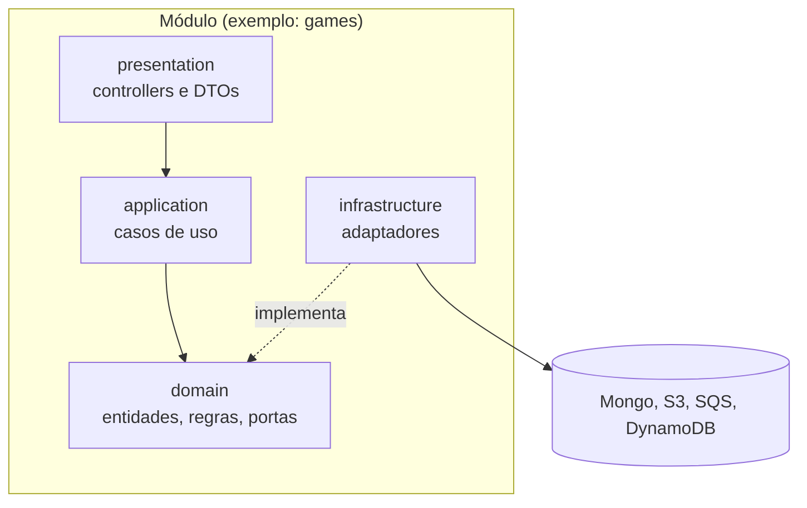

# Arquitetura de software

Este documento descreve a arquitetura de software da Plataforma Distribuída de Jogos: módulos e camadas da API, persistência, autenticação, convenções de API, cliente web, funções Lambda, testes, logs e a pilha de tecnologias. Nuvem, rede, S3, filas, implantação e ambiente local estão em [Arquitetura de nuvem](02-arquitetura-nuvem.md). Requisitos estão em [Requisitos](01-requisitos.md); esquemas de coleções, mensagens e rotas, em [Contratos e dados](04-contratos-e-dados.md); a ordem de construção, em [Plano de construção](05-plano-de-construcao.md); fluxo de trabalho e convenções de contribuição, em [Como contribuir](06-como-contribuir.md).

Glossário usado aqui:

| Termo         | Significado                                                                                      |
| ------------- | ------------------------------------------------------------------------------------------------ |
| Porta         | Interface que o domínio usa para falar com o mundo externo (banco, armazenamento, fila, relógio) |
| Adaptador     | Implementação de uma porta (Mongoose, S3, SQS, DynamoDB) ou uma versão falsa para testes         |
| Caso de uso   | Uma operação do sistema, por exemplo "publicar jogo"                                             |
| DTO           | Formato dos dados que entram e saem de uma rota                                                  |
| ODM           | Biblioteca que mapeia objetos para um banco de documentos                                        |
| DLQ           | Fila de mensagens que falharam                                                                   |
| RF, RNF, REST | Requisitos funcionais, não funcionais e restrições                                               |

## 1. Visão geral e princípios

Repositório monorepo com quatro pastas de código: `api/` (NestJS), `web/` (React com Vite), `functions/` (Lambdas) e `infra/` (Terraform). Este documento cobre as três primeiras. Cada pasta tem seu gerenciador de pacotes, seu arquivo de bloqueio de dependências e seus testes. O contrato OpenAPI é gerado pela `api/` e o cliente tipado do `web/` nasce dele.

Princípios:

1. **O domínio não conhece a infraestrutura.** Regras e casos de uso dependem de portas; adaptadores as implementam.
2. **Contrato único.** O OpenAPI sai do código e o cliente do front nasce dele.
3. **Um formato** para erros, paginação e identificadores em todo o sistema.
4. **Testável sem infraestrutura.** Tempo, identificadores, senha e armazenamento entram por portas.
5. **Cada operação altera um documento** do Mongo; contadores são derivados ou atômicos (`$inc`).
6. **Um só mecanismo de validação** (Zod) na API, nas funções e no front.



## 2. Estrutura da API (`api/`)

### 2.1 Módulos e camadas

A API é composta por módulos NestJS. Cada módulo tem quatro camadas: `presentation` (controllers e DTOs), `application` (casos de uso), `domain` (entidades, regras e **portas**) e `infrastructure` (adaptadores). A dependência aponta sempre para o domínio.

```
api/src/
├─ main.ts · app.module.ts
├─ shared/             configuração, erros, logs, autenticação, paginação, Clock, IdGenerator
├─ platform/           clientes AWS compartilhados (S3, SQS, DynamoDB)
└─ modules/
   ├─ auth/ users/ media/ offers/ games/ library/ reactions/ comments/ health/
   └─ <módulo>/
      ├─ domain/           entidades, regras e portas
      ├─ application/      casos de uso
      ├─ infrastructure/   adaptadores (Mongoose, S3, SQS, ...)
      └─ presentation/     controllers e DTOs
```

Regras de dependência:

| De               | Pode depender de                                                                    | Não pode depender de                                                        |
| ---------------- | ----------------------------------------------------------------------------------- | --------------------------------------------------------------------------- |
| `presentation`   | `application`                                                                       | `domain` direto, `infrastructure`                                           |
| `application`    | `domain` (entidades e portas)                                                       | Mongoose, SDK da AWS, Nest (além de injeção)                                |
| `domain`         | nada além da linguagem                                                              | tudo o mais                                                                 |
| `infrastructure` | `domain` (implementa portas), bibliotecas                                           | `application`                                                               |
| Um módulo        | O serviço de aplicação **exportado** por outro módulo, ou uma porta que ele declara | A infraestrutura ou o domínio interno de outro módulo; dependência circular |

### 2.2 Módulos

| Módulo      | Responsabilidade                              | Requisitos                | Armazenamento                       |
| ----------- | --------------------------------------------- | ------------------------- | ----------------------------------- |
| `auth`      | Cadastro, login, sessão, habilitar Dev        | RF-AUT-01 a 04            | Mongo (`users`)                     |
| `users`     | Perfil, perfil público, exclusão de conta     | RF-PRF-01 e 03, RF-AUT-05 | Mongo                               |
| `media`     | Pedido de envio, estado, consumo do resultado | RF-PRF-02, RF-MID-01 a 03 | Mongo (`media`), S3                 |
| `offers`    | Lista e detalhe de ofertas (leitura)          | RF-OFE-03 a 05            | DynamoDB                            |
| `games`     | Jogos, versões, catálogo, download            | RF-JOG-01 a 10            | Mongo (`games`), S3                 |
| `library`   | Biblioteca com estado                         | RF-BIB-01 a 04            | Mongo (`library`)                   |
| `reactions` | Like e dislike de itens                       | RF-OPI-01, 04             | Mongo (`reactions`)                 |
| `comments`  | Comentários, respostas e curtidas             | RF-OPI-02, 03, 05 a 07    | Mongo (`comments`, `comment_likes`) |
| `health`    | `GET /api/health`                             | RF-OPS-01                 | Mongo (verificação)                 |

### 2.3 Portas e adaptadores

| Porta                                                                                                                 | Para quê                                               | Produção          | Local e testes                      |
| --------------------------------------------------------------------------------------------------------------------- | ------------------------------------------------------ | ----------------- | ----------------------------------- |
| `UserRepository`, `MediaRepository`, `GameRepository`, `LibraryRepository`, `ReactionRepository`, `CommentRepository` | Persistência                                           | Mongoose          | Mongo em contêiner; fake em memória |
| `ObjectStorage`                                                                                                       | POST assinado, URL de leitura, `Head`, `Delete`, cópia | SDK do S3         | SeaweedFS; fake                     |
| `ResultsQueue`                                                                                                        | Receber resultados do processamento                    | SQS               | ElasticMQ; fake                     |
| `OffersReader`                                                                                                        | Ler ofertas pelo ponteiro e pelo índice                | DynamoDB          | DynamoDB Local; fake                |
| `PasswordHasher`                                                                                                      | Hash e verificação                                     | argon2id          | fake rápido                         |
| `TokenService`                                                                                                        | Emitir e validar o token                               | JWT               | igual                               |
| `Clock`, `IdGenerator`                                                                                                | Tempo e identificadores                                | sistema           | controláveis                        |
| `AccountDataEraser`                                                                                                   | Cada módulo apaga os dados do usuário                  | provedor múltiplo | fake                                |
| `ModerationPort`                                                                                                      | Moderação de imagem (Rekognition, opcional)            | Rekognition       | adaptador falso                     |

**Exclusão de conta.** O caso de uso em `users` executa todos os `AccountDataEraser` registrados pelos módulos. É reexecutável: apagar duas vezes não falha. Como não há transações multidocumento, essa reexecução é o mecanismo de consistência.

### 2.4 Transversais da API

- **Configuração.** `@nestjs/config` com esquema Zod validado na partida; sem valor padrão para segredos; a aplicação falha se algo faltar. Os segredos vêm do SSM (ver [Arquitetura de nuvem](02-arquitetura-nuvem.md)). Há um `.env.example` sem segredos.
- **Erros.** Casos de uso lançam erros de domínio (`NotFound`, `Conflict`, `Forbidden`, `Unauthorized`, `Invalid`). Um filtro global os converte em `application/problem+json` com `code` e `requestId`, sem detalhes internos.
- **Guarda da origem.** Uma guarda global verifica o cabeçalho secreto injetado pelo CloudFront e responde 403 sem ele. O valor vem do SSM; a proteção está na camada de aplicação. Alternativa: lista de prefixos do CloudFront no Security Group, sujeita à cota de regras.
- **Consumidor da fila (`media`).** Provedor com _long polling_ (20 s, até 10 mensagens, visibilidade 60 s). Valida a mensagem, aplica a transição de estado de forma **idempotente** (só se o estado atual for `pending`) e apaga a mensagem ao concluir. Mensagem inválida ou falha repetida segue para a DLQ após 3 recebimentos. Encerra com elegância ao receber o sinal de parada.
- **Segurança no código.** `helmet`; validação por schema (Zod) rejeitando campos extras; limite de tentativas em cadastro e login; sem CORS aberto (mesma origem; o Vite faz proxy no desenvolvimento); confiança no cabeçalho de IP do CloudFront; auditoria de dependências no CI; guarda global do cabeçalho secreto da origem.

## 3. Persistência

- **ODM:** Mongoose (`@nestjs/mongoose`) sobre MongoDB 8.0. Um esquema por agregado.
- **Repositórios** convertem documentos em **entidades de domínio**; o domínio e os casos de uso nunca veem documentos do Mongoose.
- **Coleções:** `users`, `media`, `games`, `library`, `reactions`, `comments`, `comment_likes`. Campos e índices de cada uma estão em [Contratos e dados](04-contratos-e-dados.md).
- **Índices** definidos nos esquemas e criados na partida da aplicação.
- **Sem transações multidocumento.** O Mongo roda como instância única, sem conjunto de réplicas. Cada operação altera um documento e usa operadores atômicos (`$inc`, `upsert`). Contadores são derivados ou atômicos; a exclusão de conta é uma tarefa reexecutável.
- **Ofertas** não ficam no Mongo: a porta `OffersReader` lê o DynamoDB pelo item-ponteiro da última execução completa e pelo índice `feed` + `dealRating` (detalhes em [Arquitetura de nuvem](02-arquitetura-nuvem.md)).

## 4. Autenticação e autorização

- **Token:** JWT de acesso, validade de 1 hora, sem refresh, em cookie `HttpOnly`, `Secure`, `SameSite=Strict`. Site e API estão na mesma origem, atrás do CloudFront, que repassa cookies para `/api/*`.
- **Sessão no front:** `GET /api/v1/auth/me` informa a sessão. Ao expirar, o front leva ao login.
- **Senhas:** argon2id pela biblioteca `@node-rs/argon2` (binários prontos, sem compilação), atrás da porta `PasswordHasher`.
- **Autorização:** guardas verificam o papel (`@Roles`); **a posse do recurso é verificada no caso de uso**. Rotas públicas (ofertas, catálogo, comentários) são marcadas explicitamente.
- **Limite de tentativas:** `@nestjs/throttler` em cadastro e login, confiando no cabeçalho de IP do CloudFront.
- **CSRF:** mitigado por `SameSite=Strict` e por exigir JSON nas rotas que alteram estado.
- **XSS:** o JavaScript do navegador não lê o token.

## 5. Convenções da API

| Item          | Convenção                                                                                                                          |
| ------------- | ---------------------------------------------------------------------------------------------------------------------------------- |
| Versionamento | Prefixo `/api/v1`; `GET /api/health` sem versão                                                                                    |
| Formato       | JSON; datas em ISO 8601 UTC; identificadores como texto opaco                                                                      |
| Paginação     | `page` e `pageSize` (máximo 50); resposta `{ items, page, pageSize, total }`                                                       |
| Erros         | `application/problem+json` (RFC 9457) com `code` estável e `requestId`; um único formato em todo o sistema                         |
| Validação     | Zod 4 nos controllers, via pipe global de Standard Schema do Nest 12 (`@Body()`, `@Query()`, `@Param()`), rejeitando campos extras |
| Tipos         | O tipo TypeScript de cada DTO é inferido do schema                                                                                 |
| OpenAPI       | Gerado pelo `@nestjs/swagger` a partir dos schemas e controllers; `api/openapi.json` versionado no repositório                     |

### 5.1 Contrato e trabalho em paralelo

1. DTOs e controllers dos requisitos prioritários são publicados cedo, respondendo 501, e `api/openapi.json` é exportado.
2. O front gera os tipos e simula as respostas (MSW) enquanto o back implementa.
3. O CI falha se `api/openapi.json` diferir do gerado: mudança de contrato aparece no PR.
4. As mensagens entre Lambda e API seguem o JSON Schema de `docs/contracts/`, com teste de contrato em cada lado.

`api/openapi.json` e `docs/contracts/` só mudam por quem é dono da `api/` (ver [Como contribuir](06-como-contribuir.md)).

## 6. Cliente web (`web/`)

```
web/src/
├─ app/         rotas, providers, layout
├─ features/    auth · offers · games · library · social · profile · media
│  └─ <feature>/   components · hooks (TanStack Query) · pages · schemas
├─ shared/      ui (componentes base), lib (cliente da API, utilitários), config
└─ api/         tipos gerados do OpenAPI
```

- **Cliente da API:** `openapi-typescript` gera os tipos do `api/openapi.json`; `openapi-fetch` faz as chamadas; os hooks do TanStack Query são escritos à mão, por funcionalidade. Alternativa se a escrita dos hooks pesar: `hey-api`.
- **Estado do servidor:** TanStack Query. Não há armazenamento global além da sessão.
- **Roteamento:** React Router. Rotas protegidas redirecionam ao login; rotas de Dev verificam o papel.
- **Sessão:** uma consulta a `GET /api/v1/auth/me`; o navegador envia o cookie.
- **Formulários:** `react-hook-form` com resolvedor Zod. A validação do formulário é conveniência; o servidor é a fonte da verdade.
- **Envio de arquivos:** um componente único pede o envio à API, envia o arquivo direto ao S3 com o POST assinado e consulta o estado até `ready` ou `rejected`.
- **Erros:** um tradutor de `problem+json` para mensagens ao usuário, em um só lugar.
- **Interface:** Tailwind e shadcn/ui com os tokens do Figma no tema. Só os componentes usados são acrescentados. Todas as telas têm estados de carregamento, vazio e erro. Textos em português do Brasil, sem biblioteca de internacionalização.
- **Simulações:** MSW gerado do contrato, para desenvolver o front antes da API e para os testes.
- **Build:** SPA estático (Vite), publicado no S3 atrás do CloudFront (ver [Arquitetura de nuvem](02-arquitetura-nuvem.md)).

## 7. Funções Lambda (`functions/`)

Cada função segue os mesmos princípios da API: `handler` fino, núcleo puro e adaptadores.

```
functions/<nome>/
├─ src/handler.ts      lê o evento, chama o núcleo, trata erros
├─ src/core/           regras puras
├─ src/adapters/       SDK da AWS
└─ test/               eventos sintéticos e adaptadores falsos
```

- Empacotamento com esbuild; `sharp` fica externo e é instalado para `linux-x64` com glibc.
- Configuração validada na partida; eventos e mensagens validados com Zod.
- TypeScript 6.0, runtime `nodejs24.x`.
- **`offers-ingest`:** busca na CheapShark (3 tentativas com espera crescente, `User-Agent` do projeto), grava o bruto no S3, normaliza (descarta itens sem `steamAppID`), grava no DynamoDB com `runId` e atualiza o ponteiro.
- **`media-processing`:** lê a quarentena, valida a imagem, remove metadados, gera a miniatura, grava em `media/`, apaga a quarentena e envia o resultado. A moderação é opcional, por sinalizador, atrás de `ModerationPort`. É idempotente: se a origem já não existe e o destino existe, só reenvia o resultado.
- **Contrato da mensagem de resultado:** JSON Schema em `docs/contracts/`. API e função o validam cada uma do seu lado, com teste de contrato; não há pacote compartilhado, para manter quatro pastas.

```json
{
  "schemaVersion": 1,
  "mediaId": "string",
  "outcome": "ready | rejected",
  "reason": "null | invalid_image | flagged",
  "key": "media/avatar/...",
  "thumbKey": "media/avatar/..._thumb.jpg",
  "width": 0,
  "height": 0,
  "processedAt": "ISO 8601 UTC"
}
```

- **Testes:** chamam o `handler` e o núcleo com eventos sintéticos e adaptadores falsos; as Lambdas não viram contêiner no ambiente local.

## 8. Testes e qualidade

| Nível         | Alvo                                                                                                                                                |
| ------------- | --------------------------------------------------------------------------------------------------------------------------------------------------- |
| Unitário      | Regras e casos de uso, com adaptadores falsos                                                                                                       |
| Integração    | Adaptadores contra Mongo, DynamoDB Local, ElasticMQ e SeaweedFS                                                                                     |
| Ponta a ponta | API completa com Supertest e emuladores, nos fluxos críticos: cadastro e login, envio com processamento, download controlado, comentários e ofertas |
| Contrato      | Mensagem de resultado (JSON Schema) e `openapi.json` contra o gerado                                                                                |
| Front         | Vitest e Testing Library para componentes e hooks, com MSW gerado do contrato; teste de fumaça ponta a ponta (opcional)                             |

- **Executor único:** Vitest na API, nas funções e no front. Os decoradores do Nest são compilados por SWC nos testes.
- **Tempo:** porta `Clock` para todo cenário com prazo (expiração de URL, TTL, token).
- **Asserções:** os testes afirmam o resultado desejado, não só o comportamento atual.
- **Qualidade estática:** TypeScript estrito, sem `any` nas fronteiras; ESLint com typescript-eslint; Prettier; Conventional Commits; PR com lista de verificação.
- **Comentários e docstrings em inglês**, dizendo o que a coisa faz, sem narrar mudanças.
- **CI:** lint, tipos, testes e build a cada PR; auditoria de dependências; comparação do `openapi.json`.
- **Validações de software a executar no início da construção** (ver [Plano de construção](05-plano-de-construcao.md)):

| #   | Verificar                                                                                                  | Alternativa se falhar                   |
| --- | ---------------------------------------------------------------------------------------------------------- | --------------------------------------- |
| S1  | Nest 12 com schemas Zod nos controllers gera `openapi.json` válido, e o `openapi-typescript` gera os tipos | `class-validator` com DTOs em classe    |
| S2  | Vitest com os decoradores do Nest (SWC) e Supertest                                                        | Jest com CommonJS                       |
| S3  | Mongoose 9 com MongoDB 8.0: índices, `upsert` e `$inc`                                                     | Driver nativo                           |
| S4  | `@node-rs/argon2`: `hash` e `verify` na imagem Docker da API                                               | `crypto.argon2` do Node 24 ou bcrypt    |
| S5  | `sharp` empacotado para `nodejs24.x` (linux-x64, glibc)                                                    | Biblioteca de imagem em JavaScript puro |
| S6  | SeaweedFS com POST assinado, URL de leitura, `CopyObject` e `forcePathStyle`                               | S3Proxy                                 |
| S7  | O CloudFront repassa o cookie de sessão para `/api/*` e a API o recebe                                     | Rever a política de origem              |

## 9. Logs e observabilidade no software

- **Biblioteca:** `pino` (com `nestjs-pino`), saída em JSON.
- **Campos:** `requestId` (o `X-Amz-Cf-Id` do CloudFront, ou gerado), usuário, rota, status e latência.
- **Redação:** senhas e cookies são redigidos.
- **Erros:** o `requestId` também sai no corpo `problem+json`, para correlacionar a resposta com o log.
- **Saúde:** `GET /api/health` (módulo `health`, com `@nestjs/terminus`) verifica o Mongo.
- **Funções:** logs estruturados no mesmo estilo; falha da Lambda de ofertas termina com erro para disparar alarme.
- Grupos de log, retenção, painel e alarmes estão em [Arquitetura de nuvem](02-arquitetura-nuvem.md).

## 10. Pilha de tecnologias

Versões exatas; os arquivos de bloqueio fixam as versões instaladas. As versões foram escolhidas pela compatibilidade entre si; o comportamento conjunto é conferido pelas validações S1 a S7 (seção 8).

| Área       | Pacote                                                                                          | Versão                                       | Observação                                                                                                                                                                              |
| ---------- | ----------------------------------------------------------------------------------------------- | -------------------------------------------- | --------------------------------------------------------------------------------------------------------------------------------------------------------------------------------------- |
| Plataforma | Node.js                                                                                         | 24 LTS (24.22.3)                             | `nodejs24.x` no Lambda; mesmo Node na imagem da API, nas Lambdas e no CI                                                                                                                |
| Plataforma | MongoDB (imagem oficial)                                                                        | 8.0                                          | Mesma versão local e na AWS                                                                                                                                                             |
| Linguagem  | TypeScript                                                                                      | 6.0.3 (`api/`, `functions/`); 5.9.3 (`web/`) | A 7.0.2 existe, mas `@nestjs/swagger` (^5.5 ou ^6), `typescript-eslint` (<6.1) e `openapi-typescript` (^5) ainda não a suportam; o `web/` fica no 5.9 por causa do `openapi-typescript` |
| API        | `@nestjs/core`, `common`, `platform-express`                                                    | 12.5.1                                       | ESM; Node 20.19+ ou 22.12+; Express 5.3                                                                                                                                                 |
| API        | `@nestjs/mongoose` e `mongoose`                                                                 | 12.0.1 e 9.12.2                              | Pares compatíveis (Mongoose ^9, Nest ^12)                                                                                                                                               |
| API        | `@nestjs/config`, `swagger`, `throttler`, `jwt`, `terminus`                                     | 12.1.1, 12.1.2, 6.8.0, 12.0.5, 12.2.0        | Todos compatíveis com o Nest 12                                                                                                                                                         |
| API        | `zod`                                                                                           | 4.6.7                                        | Validação única em API, funções e front                                                                                                                                                 |
| API        | `@node-rs/argon2`                                                                               | 2.2.2                                        | Hash de senha. Alternativas: `argon2` 0.45.2; `crypto.argon2` do Node 24 (argon2id em cerca de 40 ms numa máquina local)                                                                |
| API        | `nestjs-pino` e `pino`                                                                          | 5.3.2 e 10.4.0                               | O par exige pino ^10 e Node 22.12+                                                                                                                                                      |
| API        | `helmet`, `cookie-parser`                                                                       | 8.3.0, 1.4.7                                 | `cookie-parser` sem versão nova desde 2024; conferir com o Express 5                                                                                                                    |
| API        | `@aws-sdk/client-s3`, `s3-presigned-post`, `s3-request-presigner`, `client-sqs`, `lib-dynamodb` | 3.1171.0                                     | Todos na mesma versão                                                                                                                                                                   |
| Testes     | `vitest`, `supertest`                                                                           | 5.1.1, 7.3.2                                 | Vitest exige Node 22.12+ ou 24                                                                                                                                                          |
| Front      | `react`, `react-dom`                                                                            | 19.3.1                                       |                                                                                                                                                                                         |
| Front      | `vite`                                                                                          | 8.3.8                                        |                                                                                                                                                                                         |
| Front      | `react-router`                                                                                  | 8.5.2                                        | Exige Node 22.22+ e React 19.2.7+                                                                                                                                                       |
| Front      | `@tanstack/react-query`                                                                         | 5.108.0                                      |                                                                                                                                                                                         |
| Front      | `openapi-typescript` e `openapi-fetch`                                                          | 7.13.0 e 0.17.0                              | O par exige TypeScript 5                                                                                                                                                                |
| Front      | `react-hook-form` e `@hookform/resolvers`                                                       | 7.92.0 e 7.0.7                               | O resolvedor aceita Zod 3.25 ou 4                                                                                                                                                       |
| Front      | `tailwindcss`                                                                                   | 4.3.5                                        | Com shadcn/ui                                                                                                                                                                           |
| Front      | `msw`, `vitest`, `@testing-library/react`                                                       | 3.0.7, 5.1.1, 16.3.3                         | `msw` exige Vite 6+ e TypeScript 5.9+                                                                                                                                                   |
| Funções    | `sharp`                                                                                         | 0.35.5                                       | Node 20.9+; binários de linux-x64 com `npm install --os=linux --cpu=x64 --libc=glibc sharp`; mais memória dá mais CPU                                                                   |
| Funções    | `esbuild`                                                                                       | 0.28.2                                       | Empacota cada função; `sharp` fica externo                                                                                                                                              |
| Qualidade  | `eslint`, `typescript-eslint`, `prettier`                                                       | 10.15.0, 8.73.0, 3.10.1                      |                                                                                                                                                                                         |

## 11. Decisões de software

| Ref   | Decisão                                                                                                                                                                     | Motivo                                                                                                                                                                           | Alternativa descartada                                                                                                                      |
| ----- | --------------------------------------------------------------------------------------------------------------------------------------------------------------------------- | -------------------------------------------------------------------------------------------------------------------------------------------------------------------------------- | ------------------------------------------------------------------------------------------------------------------------------------------- |
| DS-01 | NestJS (Node, TypeScript) no back; React com Vite no front; Mongo para o domínio, DynamoDB para ofertas                                                                     | O site é estático (S3 e CloudFront); o back precisa de estrutura para camadas e testes                                                                                           | Next.js: sem SSR não traz retorno, e SSR exigiria um servidor Node que o desenho não tem                                                    |
| DS-02 | Módulos com camadas `presentation`, `application`, `domain`, `infrastructure` e portas                                                                                      | Regras e casos de uso testáveis sem Mongo, S3 ou AWS; trocar adaptador não altera regras                                                                                         | Controller chamando serviço que usa o banco direto; camadas globais em vez de módulos                                                       |
| DS-03 | Mongoose (`@nestjs/mongoose`) com repositórios que devolvem entidades, sem transações                                                                                       | Integração madura com o Nest; Mongo em instância única                                                                                                                           | Prisma (exige conjunto de réplicas); driver nativo (mais código); MikroORM (menos usado com Nest)                                           |
| DS-04 | Zod 4 como única biblioteca de validação (Standard Schema do Nest 12)                                                                                                       | Tipo, validação e OpenAPI saem do mesmo schema; já usado nas Lambdas e nos formulários. O `class-transformer`, de que o `class-validator` depende, não publica versão desde 2022 | `class-validator` com DTOs em classe (plano B se a geração do OpenAPI falhar; exige decoradores duplicados); Joi                            |
| DS-05 | JWT de 1 hora em cookie `HttpOnly`, `Secure`, `SameSite=Strict`; argon2id com `@node-rs/argon2`; guardas `@Roles`; `@nestjs/throttler`                                      | Token em `localStorage` é roubável por XSS; mesma origem permite cookie estrito                                                                                                  | Token em memória ou `localStorage` com `Authorization`; refresh por cookie (fora do MVP); `crypto.argon2` do Node 24 ou bcrypt (planos B)   |
| DS-06 | Prefixo `/api/v1`, paginação por `page` e `pageSize`, erros `problem+json` (RFC 9457)                                                                                       | Um só formato de erro e de paginação; o front trata erros em um lugar                                                                                                            | Paginação por cursor (desnecessária nesta escala); formato de erro próprio                                                                  |
| DS-07 | OpenAPI gerado do código, com esboços antecipados, versionado e verificado no CI; cliente com `openapi-typescript` e `openapi-fetch`; hooks escritos à mão; MSW do contrato | Fonte única da verdade; o front avança sem esperar o back; mudança de contrato aparece no PR                                                                                     | Contrato em YAML escrito à mão antes do código; geradores de hooks como Orval (muito código gerado); `hey-api` se a escrita dos hooks pesar |
| DS-08 | Front por funcionalidade com React Router, TanStack Query, react-hook-form com Zod, Tailwind e shadcn/ui                                                                    | Cada funcionalidade é autocontida; sem estado global além da sessão                                                                                                              | Redux ou outro estado global; copiar todos os componentes do shadcn; biblioteca de internacionalização (um só idioma)                       |
| DS-09 | Pirâmide de testes com Vitest, Supertest, Testing Library, porta `Clock` e testes de contrato; ESLint com typescript-eslint                                                 | Um só executor; regras verificadas sem infraestrutura; fluxos críticos com teste real                                                                                            | Jest com `ts-jest` (atrito com os pacotes ESM do Nest 12; plano B); `oxlint` (menos regras que usam tipos); só ponta a ponta                |
| DS-10 | Lambdas com `handler` fino, núcleo puro e adaptadores; contrato da mensagem como JSON Schema em `docs/contracts/`                                                           | Núcleo testado sem a AWS; sem quinta pasta para código compartilhado                                                                                                             | Pacote compartilhado entre API e funções; lógica dentro do `handler`                                                                        |
| DS-11 | Node 24 LTS em todo o repositório; TypeScript 6.0 na `api/` e em `functions/`, 5.9 no `web/`                                                                                | O mesmo Node em todo lugar; TypeScript 7 sem suporte nas ferramentas citadas                                                                                                     | Node 26 (runtime do Lambda ainda em prévia); TypeScript 7                                                                                   |
| DS-12 | Guarda global do cabeçalho secreto da origem                                                                                                                                | A API é pública e só deve ser acessada pelo CloudFront                                                                                                                           | Lista de prefixos do CloudFront no SG (plano B, sujeita à cota); nenhuma proteção                                                           |
| DS-13 | Consumo da fila de resultados idempotente, com DLQ após 3 recebimentos                                                                                                      | A API pode receber a mesma mensagem mais de uma vez; a Lambda não acessa o Mongo                                                                                                 | Lambda chamando a API por HTTP                                                                                                              |
